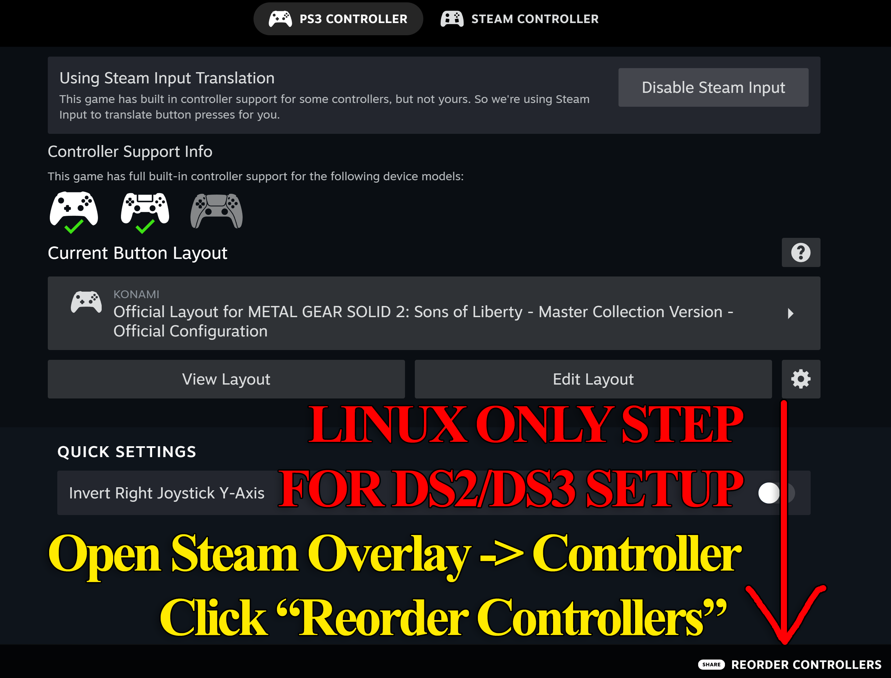
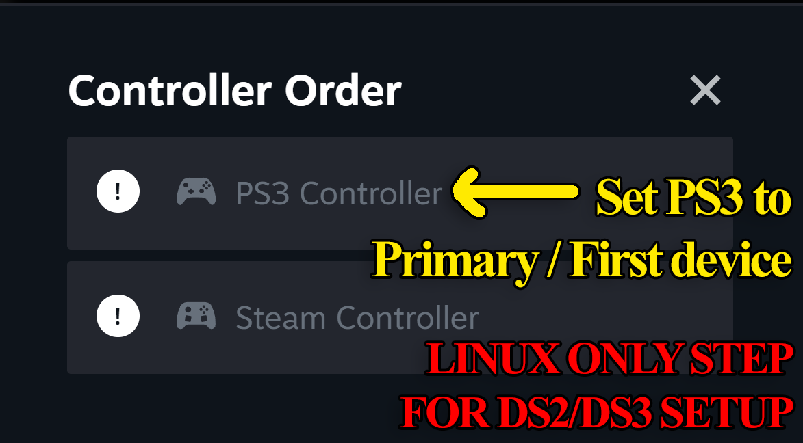
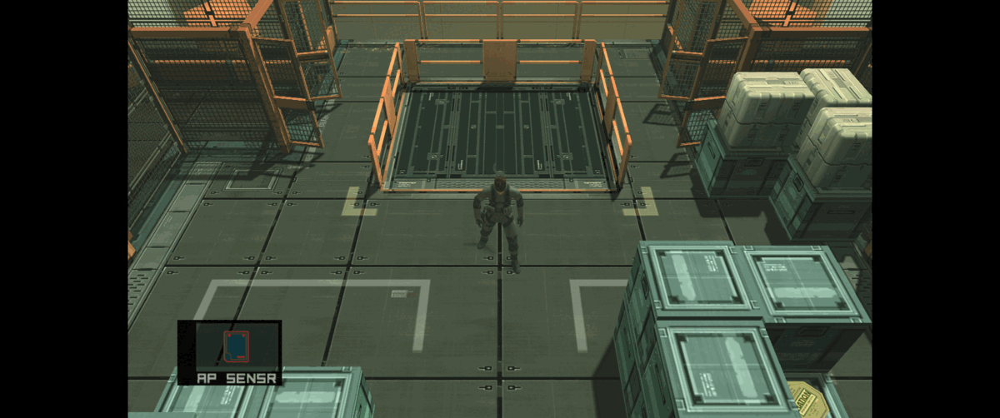
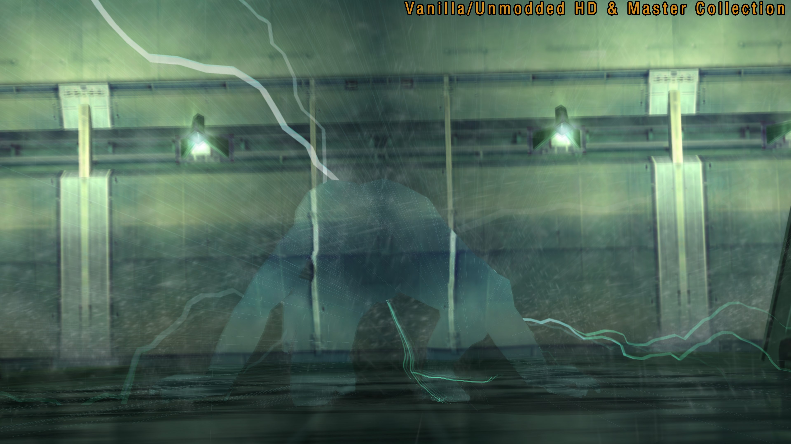
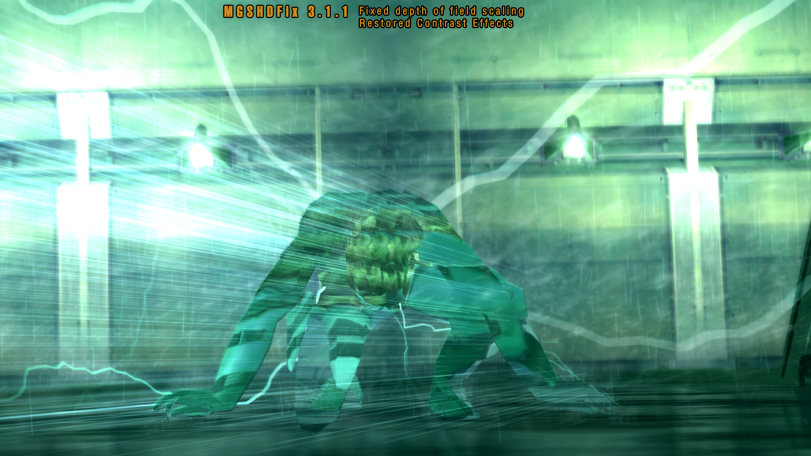

# MGSHDFix: Restoring MGS Master Collection Visuals & Stability for Windows

### 💻 PowerShell Installer

   

---

MGSHDFix drags the Metal Gear Solid Master Collection back to something worth staring at: broken visual effects restored, vanilla crashes stomped out for good, and custom resolutions unlocked so the whole thing finally fits your screen the way it was meant to. Built by modders, for anyone who's ever bounced off a port and wondered what could have been, it treats the PC releases as a starting point rather than a finished statement. Whether you're chasing a clean vanilla experience or a lovingly over-tuned one, the option toggles are yours to break, bend, and rebuild. Fire it up and see what's been lying under the surface all along.

## ✅ Requirements

- **PowerShell 5.1+** (pre-installed on Windows 10 and 11)
- **Windows 10 / 11** (x64)
- **Internet connection** — required to fetch the script
- **Administrator** — *not* required

## Briefing

Welcome to the frontline, operative. If you've booted up the Metal Gear Solid Master Collection and felt that ache in your gut — the flicker of a broken shader, the missing bloom on a spotlight, the crash that drops you back to the desktop right when the alert phase kicks in — you're not alone. MGSHDFix exists because this collection deserved better, and because the community that loves these games has always finished the job.

This is a restoration effort and an enhancement suite rolled into one. We patch the visual effects that the HD Collection left on the cutting room floor, stabilize the crashes that haunted vanilla installs, and open the door to custom resolutions, ultrawide aspect ratios, and a pile of quality-of-life options the original releases never dreamed of. Think of it as a field kit for anyone who wants their copy of the Master Collection firing on all cylinders — whether you're a purist chasing original hardware fidelity, a speedrunner hunting for frame-perfect consistency, or just someone who wants the rain to sound like rain and the codec to sound like codec.

Built by modders, tuned for modders. If you like to tinker, you'll feel right at home — most features are toggles in a config tool, nothing is forced, and the fix is designed to play nice with other mods in your loadout. But if you just want to plug in and play, the defaults do the heavy lifting for you.

Please note: MGSHDFix is a fan-made preservation project. It is not affiliated with or endorsed by the rights holders of the Metal Gear franchise, and all trademarks belong to their respective owners. We're just players who wanted these classics to look and play the way they deserve on PC.

## What It Fixes

Alright, soldier — let's talk about what's actually broken out there.

The Master Collection shipped with a whole host of wounds, and MGSHDFix is the field medic that patches them up. Here's what it brings back from the dead:

**Visual effects, restored.** Post-processing effects that vanished during the 2011 HD Collection era and never made it back — heat haze, motion blur, underwater wobble, depth-of-field concentration blur, contrast filters in cutscenes, the lot — are all back where they belong. Vector effects like rain, lasers, and bullet trails scale correctly now instead of looking like they were drawn on a postage stamp.

**Crashes and hangs, dealt with.** The Stillman Strut C hang, the alt-tab audio desync and broken loading zone bugs, the game refusing to close cleanly in the background — all addressed. Games now exit without leaving a ghost process lurking in your task manager.

**Aspect ratio and UI, corrected.** Ultrawide gameplay and cutscenes actually fill the screen properly. UI scaling no longer breaks. Window sizing behaves on High DPI displays. Blind rendering (the lines on Codec portraits, nightvision, thermals) scales with resolution instead of pixelating into mush.

**Audio issues, patched up.** The infamous "rain is louder than every Codec conversation" mix is fixable. Reverb that was nearly inaudible gets boosted. Stereo output can be forced for those who need it.

**Hundreds of typos, scrubbed.** Across MGS2 and MGS3 both — menus, subtitles, item descriptions, codec transcripts, novel text. The squished English weapon descriptions in the item menu? Fixed.

**Console-exclusive content and cut content, reinstated.** Missing sprites in MG1's opening, misplaced and missing doors in MG2, the lighter flame sprites, elevator floor lamps, cigarette smoke timings — restored. Cancelled Bluepoint camera modes become playable options rather than lost artifacts.

**Performance, shored up.** Rewritten processing functions and a prefetch system that loads adjacent room assets ahead of time cut load times and slash CPU usage. The idle wait bug that was silently chugging your processor? Gone.

**Save corruption, prevented.** The Steam Cloud "DAMAGED SAVE" bug — the one that made your file look like it went through a paper shredder — is fixed.

Every fix in the ledger exists because someone noticed something was off and went in after it. If you spot one we missed, the field report box is always open.

## Field Installation

Getting MGSHDFix onto your rig is deliberately straightforward—no launcher rituals, no dependency dances. The fix lives alongside your game installation and works its magic the moment the collection boots.

Start by locating the folder where your Master Collection copy is installed. Drop the fix's contents into the game directory so everything sits next to the executables. If you prefer to keep the fix self-contained, you can instead place it in a dedicated folder and point your setup at it—either way works, and neither touches your original game files beyond what's needed to load the fix.

Once the files are in place, launch the game through your usual method: Steam, the collection's own launcher, or a shortcut you've pinned. The fix initializes automatically and will generate a configuration file on first run so you can dial in your resolution, HUD behavior, and all the other toggles at your leisure.

A few field notes worth carrying with you:

- **Back up first.** Even a clean fix deserves a parachute. Copy your save files somewhere safe before your first launch with the fix active.
- **One version, please.** If you've tinkered with earlier builds, clear them out before deploying a new one so you're not running two fixes that fight over the same hooks.
- **Config lives locally.** All your settings live in a plain-text file you can hand-edit or share with a friend. Change a value, save, relaunch—that's the whole loop.
- **Uninstalling is reversible.** Remove the fix's files and the game returns to its vanilla state, save data intact.

The fix is built to coexist with other mods that respect the same conventions. If something clashes, check load order and folder placement before assuming the worst—most conflicts are just two tools reaching for the same door.

For speedrunners and tinkerers, the configuration file exposes the same knobs the in-game menus do, so you can script a known-good loadout and swap it in whenever you're chasing a route. Modders looking to build on top of the fix will find the folder layout familiar and approachable.

## 📸 Screenshot

## System Requirements

**Before you deploy:** This fix is built for the PC version of the Metal Gear Solid Master Collection. It won't do a thing for consoles, emulators, or the original PS2 discs — Solid Snake doesn't work that way.

**The rig you'll need:**
- **OS:** Windows 10 or 11 (64-bit). The launcher chokes on anything leaner, and Linux users will have to go through Proton and hope the rain audio behaves.
- **The Game:** A legitimate PC copy of the Master Collection, at least Volume 1. The fix patches files in place, so the vanilla install needs to be there first — no game, no fix.
- **Where it lives:** The fix expects to sit next to the game's executable in its install folder. If you've moved the collection to an external drive or a custom directory, that's fine; just make sure the patch follows the game there.
- **Modding mindset:** This thing plays nice with other mods, but load order and file conflicts are your responsibility. Back up your files before you start swapping things around. If you break it, you get to keep both pieces.

**Recommended (but not strictly required):**
- A GPU that can actually stretch its legs at higher resolutions and ultrawide aspect ratios — the whole point of this fix is that the vanilla letterboxing and broken effects get out of the way of your monitor's native res.
- Enough disk space for a backup copy of the original files, in case you ever want to go back to the unpatched, broken version. (You won't.)
- A controller with dual analog sticks if you want the pressure-sensitive and custom glyph support to be worth anything.
- Patience for the first launch as the fix hooks into the game — give it a moment to do its thing before you start mashing buttons.

**What you don't need:** Pip, Node, a compiler, or any other arcane developer ritual. This is a drop-in fix, not a build-from-source project. If you've got the game installed and you've unzipped the fix, you're already most of the way to deployment.

## Acknowledgements

Every fix in this project stands on the shoulders of a small army of tinkerers, reverse-engineers, and lore-keepers who gave their time and know-how so the rest of us could get a cleaner run through Shadow Moses, the Big Shell, and Zanzibar Land. If you've ever filed a bug report with a stack trace and a save attached, you're one of them. If you've poked at a hex editor at 3 AM because a texture just didn't look right, you're one of them too.

The speedrunning and community bugfix crews deserve a special salute — you caught the regressions, the timing quirks, and the weird edge cases that no lone modder would find alone, and the load-optimization and IGT work in this fix exists largely because of your patience and notes. To the translators and font-labelers who keep pushing for more languages and better text rendering: keep shouting, we're listening. To everyone who restored a track, matched a palette, or confirmed an effect on original hardware so we could compare against it — thank you for being the reference bench.

And to the players: thank you for the crash logs, the "did you notice this" threads, the screenshots, and the simple act of installing the fix and telling a friend. You turn a patch into a project. If you spot a missing restoration or a regression we overlooked, the door's open — open an issue, drop a line, or just point at the screen and say "that's wrong." That's how this thing grows.

*This fix is a labor of love for a series that taught a lot of us to crouch before the corner, check the radar, and never trust a hallway without a cardboard box nearby. o7*

## License & Sharing

Built in the open, shared with the community. MGSHDFix is released under the MIT License — tinker with it, fork it, learn from it, ship improvements back. Credits and acknowledgements live in the project's documentation; keep them intact if you redistribute.

Found a bug? Fixed something broken? Send a pull request. This fix exists because the community refused to let the Master Collection go down the way it arrived — every crash fixed and every effect restored belongs to everyone who plays it. If MGSHDFix helped you, pass the favor on: share the project, help a newcomer get un-stuck, or leave a note for the next modder who walks this way.